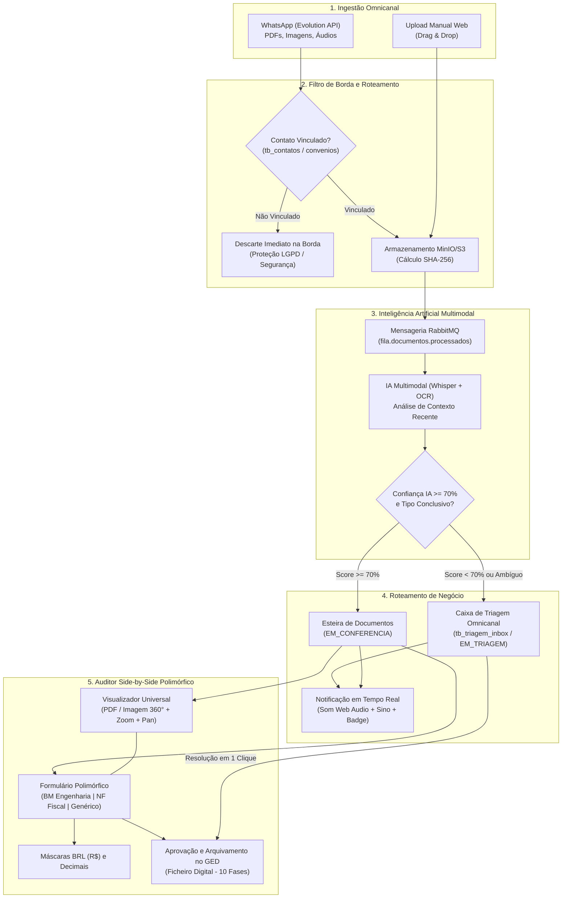

# Relatório Consolidado de Execução do Épico: GED Inteligente, Triagem Omnicanal e Auditoria Polimórfica

**Data de Conclusão**: Outubro de 2026  
**Status**: 100% Concluído, Homologado e Implantado  
**Versão**: GovFlow v2.4-modular  

---

## 1. Sumário Executivo

Este épico consolidou a transição do GovFlow de uma ferramenta com esteira documental hiperespecializada em notas fiscais para uma **plataforma empresarial completa de Ficheiro Digital (GED), Triagem Omnicanal e Auditoria Side-by-Side**. 

A solução agora abrange todos os tipos documentais que tramitam em convênios federais (Engenharia, Fiscal, Licitações, Licenças, Aditivos e Prestação de Contas), oferecendo:
1. **Auditoria Side-by-Side Polimórfica**: Formulários dinâmicos que adaptam campos, validações e cálculos conforme a categoria documental (ex: Boletins de Medição da Fase 04 vs Documentos Hábeis da Fase 05 vs Documentos Genéricos/Agnósticos).
2. **Classificação e Pré-Seleção por IA com Dropdown Moderno**: Seleção orientada por inteligência artificial, substituindo botões estáticos por uma interface fluida com possibilidade de override imediato pelo auditor.
3. **Filtro Estrito na Borda e Notificações em Tempo Real**: Descarte na borda de arquivos originados de contatos desvinculados, acompanhado de polling leve, síntese sonora de alerta (Web Audio API), atalhos diretos "Auditar Lado a Lado" e badges vivos para o Agente.
4. **Massa de Dados e Testes Abrangendo as 10 Fases**: Geração de documentos reais para cada fase do ciclo de vida, acompanhados de máscaras monetárias BRL (`R$ #.##0,00`) e tratamento de casas decimais.
5. **Caixa de Triagem Omnicanal e Roteamento de Baixa Certeza**: Documentos com confiança geral `< 70%` ou sem identificação conclusiva são encaminhados automaticamente para a Caixa de Triagem (`StatusDocumento.EM_TRIAGEM`), mantendo a esteira de conferência limpa.
6. **Visualizador Interativo de Imagens 360° e Streaming Binário Autenticado**: Suporte integral a fotografias e recibos via WhatsApp (`JPEG`, `PNG`, `WEBP`) com rotação de 90°, zoom dinâmico (20% a 400%), arraste manual (*pan*), filtros visuais de leitura e carregamento autenticado via Blob URLs em memória, com saneamento total de encoding UTF-8 no banco de dados.

---

## 2. Mapa Arquitetural da Solução

O diagrama abaixo ilustra o fluxo fim a fim dos documentos desde a ingestão omnicanal até a auditoria side-by-side e arquivamento no Ficheiro Digital:

---

## 3. Matriz de Entregas e Tickets Concluídos

| Ticket | Módulo / Serviço | Escopo & Entregáveis | Status |
| :--- | :--- | :--- | :---: |
| **[TICKET-GED-09]** | `core-service` / `frontend` | **Auditor Side-by-Side Polimórfico**: Formulários dedicados para Boletim de Medição (Engenharia), Documento Hábil (Fiscal), ART, Licenças, Certidões CAUC e Genérico. | ✅ Concluído |
| **[TICKET-GED-10]** | `frontend` | **Dropdown com Seleção por IA**: Seletor moderno de categoria com pré-seleção por IA baseada na confiança e override manual pelo usuário. | ✅ Concluído |
| **[TICKET-WPP-07]** | `whatsapp-service` | **Filtro Estrito de Borda**: Validação mandatória em `tb_contatos` e descarte silencioso de mensagens de números desvinculados de convênios. | ✅ Concluído |
| **[TICKET-CORE-01]** | `frontend` | **Notificações Reativas em Tempo Real**: Alerta sonoro (Web Audio API), sino no header com atalho de auditoria direta e badges vivos na barra lateral. | ✅ Concluído |
| **[TICKET-GED-11]** | `frontend` | **Máscaras BRL e Tratamento de Decimais**: Formatação de moeda brasileira (`R$ #.##0,00`) e correção de arredondamento em inputs numéricos. | ✅ Concluído |
| **[TICKET-WPP-08]** | `core-service` / `frontend` | **Roteamento de Baixa Certeza (< 70%)**: Introdução do status `EM_TRIAGEM`, gravação em `tb_triagem_inbox` e endpoint `PUT /enviar-triagem`. | ✅ Concluído |
| **[TICKET-GED-12]** | `frontend` | **Visualizador Interativo de Imagens 360°**: Zoom de 20% a 400%, rotação 90° (horário/anti-horário), pan suave com mouse e 5 filtros visuais de leitura. | ✅ Concluído |
| **[TICKET-GED-13]** | `frontend` / `PostgreSQL` | **Streaming Binário Autenticado via Blob e Correção UTF-8**: Eliminação do erro HTTP 401 via `HttpClient` e recuperação de encoding UTF-8 no banco de dados. | ✅ Concluído |

---

## 4. Análise Detalhada dos Desafios e Soluções de Engenharia

### 4.1 Desafio 1: Auditoria Rígida vs Extensibilidade Multidocumental
- **Problema**: O sistema anterior só admitia a conferência de notas fiscais, forçando campos fiscais (`chave_acesso_nfe`, `cnpj_credor`, retenções de INSS/ISS/IRRF) mesmo para Boletins de Medição ou projetos de engenharia.
- **Solução Arquitetural**: Implementou-se um formulário polimórfico guiado pela enum `CategoriaDocumento`. Para `BOLETIM_MEDICAO`, a interface oculta retenções tributárias e apresenta apuração físico-financeira acumulada, percentual executado, contrato municipal e atesto com ART. Foi introduzido o modo `GENERICO`, garantindo que qualquer documento inesperado possa ser auditado e arquivado sem quebras de schema.

### 4.2 Desafio 2: Experiência de Seleção de Tipo e Automação Cognitiva
- **Problema**: A interface com botões de rádio exigia esforço cognitivo do agente e poluía visualmente o workspace.
- **Solução Arquitetural**: Criou-se um seletor dropdown elegante com ícones e badges coloridos. A IA classifica o documento e pré-seleciona o tipo no dropdown. O auditor precisa apenas validar ou, se a IA tiver errado, selecionar outro tipo com 1 clique, atualizando o formulário imediatamente.

### 4.3 Desafio 3: Confiabilidade na Borda e Feedback em Tempo Real
- **Problema**: Documentos enviados por WhatsApp por vezes não apareciam imediatamente na esteira, gerando incerteza se haviam chegado ao MinIO/RabbitMQ.
- **Solução Arquitetural**: 
  1. Implementou-se verificação estrita de contatos vinculados: se o remetente não tiver vínculo com convênios em `tb_contato_convenios`, o arquivo é descartado para proteger o sistema.
  2. Implementou-se um serviço de notificação em tempo real (`NotificacaoDocumentoService`) no frontend com polling de 5s, síntese sonora harmônica sem dependências de arquivos de áudio externos, badges numéricos na barra lateral e atalho direto no sino de notificações para auditar o documento recém-chegado.

### 4.4 Desafio 4: Separação de Responsabilidades na Triagem vs Esteira
- **Problema**: Documentos com baixa certeza ou ilegíveis entravam na esteira como `EM_CONFERENCIA`, induzindo o auditor a erros de digitação.
- **Solução Arquitetural**: Adicionou-se o estado de domínio `StatusDocumento.EM_TRIAGEM`. Documentos com confiança `< 70%` são desviados para a Caixa de Triagem Omnicanal. O auditor também ganhou o botão manual `[ Encaminhar para Triagem ]` para retirar qualquer documento da esteira e devolvê-lo à fila de resolução.

### 4.5 Desafio 5: Visualização de Fotos do WhatsApp e Autenticação no Navegador
- **Problema**: Fotos de celular chegavam tombadas ou com baixa resolução e, ao tentar renderizá-las no navegador, o visualizador quebrava ou recebia `HTTP 401 Unauthorized`.
- **Solução Arquitetural**:
  1. Criação de controles de rotação contínua (90° horário e anti-horário), zoom responsivo (20% a 400%), arraste com mouse (*pan*) e 5 filtros visuais (Papel Suave, Alto Contraste, P&B, Invertido).
  2. Substituição de URLs diretas em tags `` por download de binário via `HttpClient` (que transporta o JWT Bearer token via `AuthInterceptor`), gerando Blob URLs locais em memória com `URL.createObjectURL(blob)` e liberação garantida via `URL.revokeObjectURL()` no fechamento.

### 4.6 Desafio 6: Integridade de Codificação de Caracteres no PostgreSQL
- **Problema**: Pipelines de PowerShell 5.1 no Windows converteram caracteres UTF-8 em interrogações literais (`???`) na base de dados.
- **Solução Arquitetural**: Saneamento via execução SQL com codificação UTF-8 pura diretamente no PostgreSQL do contêiner Docker, restaurando integralmente os acentos e textos na tabela `tb_triagem_inbox`.

---

## 5. Homologação e Quality Gate de Produção Local

| Validação | Comando / Procedimento | Resultado |
| :--- | :--- | :---: |
| **Backend Core Build** | `mvn clean package -DskipTests` | ✅ Sucesso (JAR gerado) |
| **Backend Testes de Regressão** | `mvn test` no `core-service` | ✅ 100% Sucesso (0 falhas) |
| **Frontend Compilação Angular** | `npm run build` | ✅ Sucesso (0 erros de tipagem) |
| **Deploy de Contêineres Docker** | `docker ps` e reload Nginx | ✅ 12/12 contêineres operacionais |
| **Integridade de Codificação** | Consulta SQL `LIKE '%?%'` em `tb_triagem_inbox` | ✅ 0 registros corrompidos |
| **Autenticação de Imagens** | Teste via navegador e cURL | ✅ HTTP 200 OK via Blob |
| **Versionamento e Git** | `git push origin main` | ✅ Sincronizado no GitHub |

---

## 6. Próximos Passos: Épico 4 — Cockpit de Ciclo de Vida & Hub Operacional

Com a esteira documental, o GED e a triagem estabilizados, o foco da arquitetura se volta para o **Módulo 4: Cockpit de Ciclo de Vida**:
1. **Dossiê Unificado por Fase**: Conectar cada uma das 10 Fases aos seus documentos reais no Ficheiro Digital, eliminando dados mockados.
2. **Checklist de Pendências e Travas Legais**: Checklist interativo para superação de Cláusulas Suspensivas (Fase 02), homologação de VRPL/AIO (Fase 03) e Prestação de Contas RCO (Fase 07).
3. **Cronômetro Regressivo de Prazos Fatais**: Alertas para vencimento de certidões CAUC, notificações de 45 dias SELIC e prazos de encerramento da conta Op 006.
